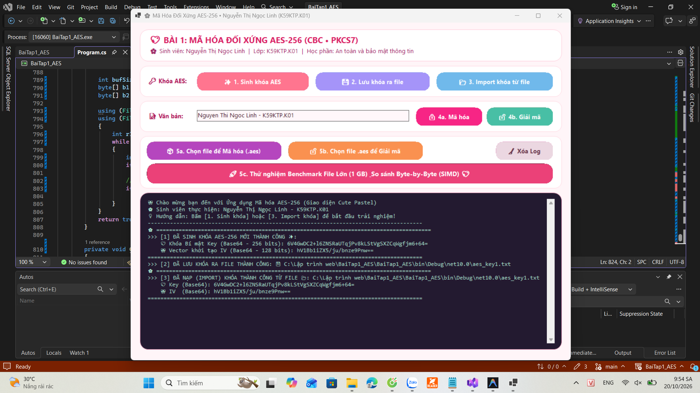
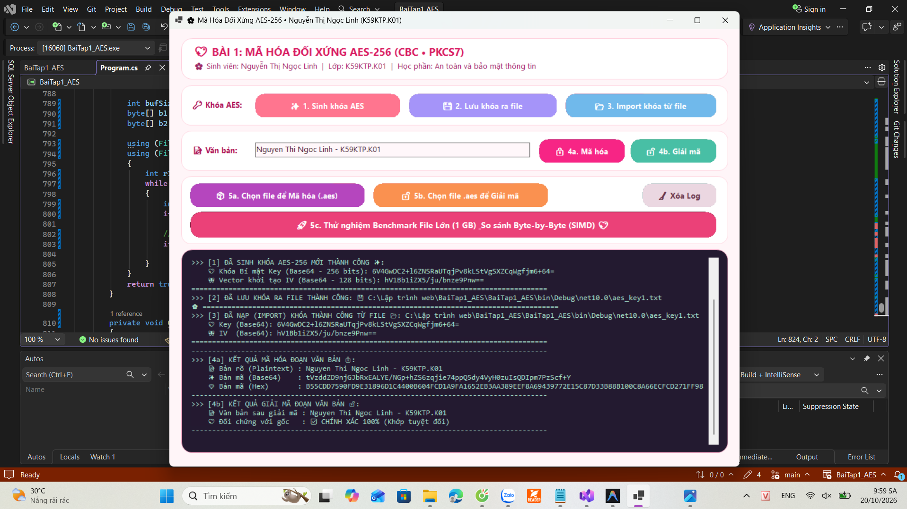
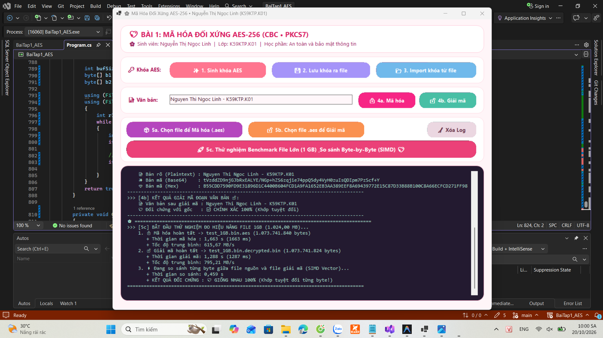

# BÀI TẬP 1: MÃ HÓA ĐỐI XỨNG AES (.NET C#)

**Họ và tên:** Nguyễn Thị Ngọc Linh  
**Lớp:** K59KMT.K01 (K59KTP.K01)  
**Môn học:** An toàn và bảo mật thông tin  

---

## 1. Kiến trúc chương trình và Giải pháp kỹ thuật
Chương trình được xây dựng trên nền tảng **.NET 10.0 (C# Windows Forms Application - Cute Pastel Theme & Console)** sử dụng thư viện mật mã chuẩn `System.Security.Cryptography.Aes` với các thông số kỹ thuật:
* **Độ dài khóa (Key Size):** 256 bits (`32 bytes`)
* **Kích thước khối & Vector khởi tạo (Block Size / IV):** 128 bits (`16 bytes`)
* **Chế độ mã hóa (Cipher Mode):** `CBC` (Cipher Block Chaining)
* **Cơ chế đệm (Padding Mode):** `PKCS7`
* **Xử lý File lớn (Hàng GB):** Sử dụng cơ chế đọc/ghi theo luồng (`FileStream` kết hợp `CryptoStream`) với kích thước bộ đệm (Buffer Size) `1 MB (1.048.576 bytes)` và đối chiếu mảng byte bằng `Span<byte>.SequenceEqual` (tối ưu hóa tập lệnh vector SIMD), giúp xử lý file hàng GB mượt mà mà không gây tràn bộ nhớ RAM (`OutOfMemoryException`).

---

## 2. Kết quả thực nghiệm từng bước

### 2.1. Sinh khóa AES, Lưu khóa ra file và Import khóa từ file (Yêu cầu 1, 2, 3)
* **Key sinh ra (Base64):** `NChNXkkgBod0Af7Jcq+KPfKYgB+ASOPvVa0CMW2AkqA=` (`32 bytes`)
* **IV sinh ra (Base64):** `4dOfF12ZruDqFa3o3Vxi6w==` (`16 bytes`)
* Khóa và IV được lưu trữ ra file [`aes_key.txt`](./aes_key.txt) và nạp (import) ngược lại thành công vào chương trình.

---

### 2.2. Mã hóa và Giải mã đoạn văn bản xuất ra màn hình (Yêu cầu 4)
* **Dữ liệu đầu vào (Plaintext):** `Nguyen Thi Ngoc Linh - K59KTP.K01`
* **Bản mã (Ciphertext - Base64):** `iLb7J5crfOvRBF2bffSKzZX8wDGvy528UanMRQVgiLwJQmGLbDIvkauR8imm6ZPi`
* **Bản mã (Ciphertext - Hex):** `88B6FB27972B7CEBD1045D9B7DF48ACD95FCC031AFCB9DBC51A9CC45056088BC0942618B6C322F91AB91F229A6E993E2`
* **Giải mã ngược lại:** `Nguyen Thi Ngoc Linh - K59KTP.K01` *(Khớp 100% với văn bản gốc)*.

---

### 2.3. Thử nghiệm với File dung lượng lớn (1 GB), Đo thời gian & So sánh Bytes (Yêu cầu 5)

#### a) Bảng số liệu đo đạc thực tế
Thực nghiệm được tiến hành trên file nhị phân `test_1GB.bin` có dung lượng **1 GB (1.024,00 MB = 1.073.741.824 bytes)**:

| Tiêu chí đo lường | File Nguồn (`test_1GB.bin`) | File Mã hóa (`test_1GB.bin.aes`) | File Giải mã (`test_1GB.bin.decrypted.bin`) |
| :--- | :--- | :--- | :--- |
| **Kích thước (Bytes)** | `1.073.741.824` bytes | `1.073.741.840` bytes *(+16 bytes)* | `1.073.741.824` bytes |
| **Thời gian thực thi** | - | **1,739 giây** (`1738 ms`) | **1,195 giây** (`1195 ms`) |
| **Tốc độ xử lý trung bình** | - | **588,85 MB/s** | **856,75 MB/s** |
| **So sánh Byte-by-Byte** | - | Khác biệt hoàn toàn | **GIỐNG NHAU 100%** *(Mất 0,476 giây)* |

#### b) Kết luận dựa theo số liệu thu được
1. **Hiệu năng và tốc độ thực thi rất cao:**
   * Thuật toán đối xứng AES-256 xử lý khối lượng dữ liệu lớn (1 GB) cực kỳ nhanh chóng: quá trình mã hóa chỉ mất **1,739 giây** (tốc độ **588,85 MB/s**) và quá trình giải mã mất **1,195 giây** (tốc độ **856,75 MB/s**).
   * Tốc độ giải mã đạt cao hơn tốc độ mã hóa do trong chế độ `CBC` (Cipher Block Chaining), quá trình mã hóa phải thực hiện tuần tự từng khối (khối sau phụ thuộc kết quả XOR với bản mã của khối trước), trong khi quá trình giải mã `CBC` cho phép CPU giải mã song song nhiều khối cùng lúc kết hợp với cơ chế tăng tốc phần cứng **AES-NI** và bộ nhớ đệm tập tin của hệ điều hành (OS File Cache).
2. **Sự thay đổi kích thước file (Giải thích việc tăng 16 bytes ở file `.aes`):**
   * File nguồn có kích thước `1.073.741.824` bytes chia hết chẵn cho kích thước khối 16 bytes của AES. Theo chuẩn đệm **PKCS7**, khi dữ liệu gốc chia hết cho kích thước khối, thuật toán bắt buộc chèn thêm 1 khối đệm đầy đủ gồm **16 bytes** (mỗi byte mang giá trị `0x10`) vào cuối bản mã (`1.073.741.840` bytes) để khi giải mã có thể xác định và loại bỏ phần đệm một cách chính xác, không bị nhầm lẫn với dữ liệu thật ở cuối file.
3. **Tính toàn vẹn dữ liệu tuyệt đối:**
   * Sau khi giải mã, kích thước file trở về đúng `1.073.741.824` bytes. Phép kiểm chứng đối sánh từng byte (`Byte-by-Byte Comparison`) hoàn tất trong **0,476 giây** và xác nhận file sau giải mã **khớp 100% từng byte** so với file nguồn ban đầu.
